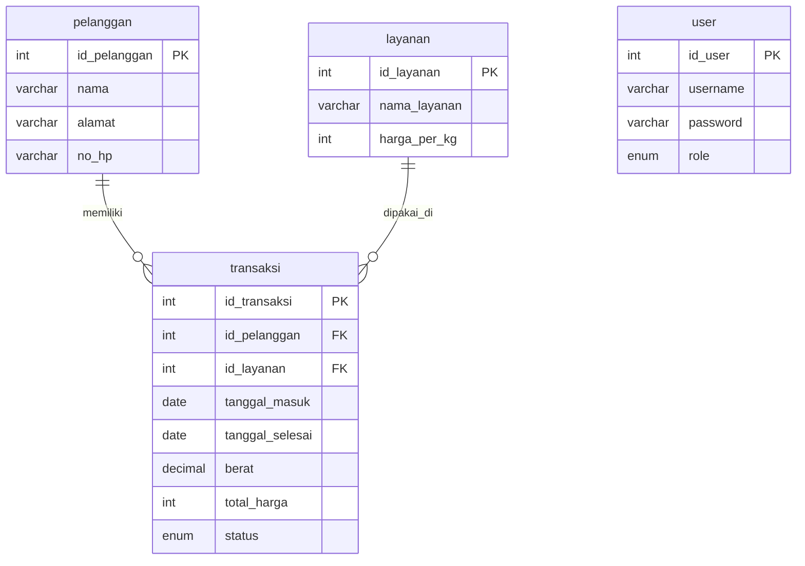

# PWEB Pertemuan 11: CRUD Laundry
---

# LaundryCrafty: Aplikasi Web Manajemen Laundry

## 1. Gambaran Umum

LaundryCrafty adalah aplikasi web untuk mengelola usaha laundry, dibuat dengan **PHP 8, MySQL/MariaDB, dan Bootstrap 5**. Semua data pelanggan, jenis layanan, dan transaksi disimpan di MySQL. Biaya cucian dihitung sendiri oleh sistem dari berat dan harga layanan, lalu hasilnya bisa dilihat dalam laporan pendapatan per hari, minggu, atau bulan.

**Cakupan aplikasi:** data pelanggan, data layanan, pencatatan transaksi, pelacakan status cucian, laporan pendapatan, login dengan dua level akses (admin dan kasir), dashboard ringkasan, cetak nota, serta API JSON sebagai fitur tambahan.

## 2. Kebutuhan Sistem

### 2.1 Daftar fitur

| Fitur | Penjelasan | File |
|-------|-----------|------|
| Data pelanggan | Menambah, mengedit, menghapus, dan menampilkan pelanggan. Bisa dicari lewat nama atau nomor HP. | `pelanggan.php`, `pelanggan-form.php`, `pelanggan-proses.php` |
| Data layanan | Mengatur jenis layanan dan tarif per kilogram (Cuci Kering, Cuci Setrika, Express). Layanan yang sudah pernah dipakai transaksi ditolak saat dihapus. | `layanan.php`, `layanan-form.php`, `layanan-proses.php` |
| Pencatatan transaksi | Memilih pelanggan dan layanan, mengisi berat serta tanggal masuk dan selesai. Total bayar muncul otomatis. | `transaksi.php`, `transaksi-form.php`, `transaksi-proses.php` |
| Status cucian | Progres cucian (Proses, Selesai, Sudah Diambil) diganti lewat dropdown langsung di tabel tanpa membuka form. | `transaksi.php`, `transaksi-proses.php` |
| Laporan pendapatan | Rekap per hari, minggu, atau bulan, plus filter rentang tanggal. Menampilkan total pendapatan, jumlah transaksi, dan total berat cucian. | `laporan.php` |
| Login dan hak akses | Masuk dan keluar memakai session, dengan halaman yang dibatasi sesuai peran. | `login.php`, `logout.php` |
| Dashboard | Ringkasan jumlah pelanggan, total transaksi, cucian yang sedang diproses, pendapatan bulan berjalan, dan grafik 7 hari terakhir dengan Chart.js. | `index.php` |
| Pencarian | Pelanggan dicari lewat nama atau no HP. Transaksi dicari lewat nama pelanggan atau tanggal masuk (format `YYYY-MM-DD`). | `pelanggan.php`, `transaksi.php` |
| Nota | Struk transaksi yang siap dicetak. | `nota.php` |
| API JSON | Endpoint untuk pelanggan, transaksi, dan laporan. | `api.php` |

### 2.2 Level akses pengguna

| Peran | Yang boleh dilakukan |
|-------|----------------------|
| **Admin** | Punya akses penuh: pelanggan, layanan, transaksi, dan laporan. Hanya admin yang bisa menghapus pelanggan dan transaksi, mengatur layanan, serta membuka laporan. |
| **Kasir** | Fokus pada operasional harian: melihat, mencari, menambah, dan mengedit pelanggan; membuat dan mengedit transaksi; mengganti status cucian; mencetak nota. Menu Layanan dan Laporan tertutup, dan kasir tidak bisa menghapus data. |

## 3. Desain Database

Database `laundrycrafty` memiliki empat tabel dengan engine InnoDB dan charset `utf8mb4`.

### 3.1 Tabel `pelanggan`

| Kolom | Tipe | Catatan |
|-------|------|---------|
| id_pelanggan | INT, primary key | Naik otomatis |
| nama | VARCHAR(64) | Tidak boleh kosong |
| alamat | VARCHAR(255) | Tidak boleh kosong |
| no_hp | VARCHAR(20) | Tidak boleh kosong; panjang 8 sampai 20 karakter, hanya angka dan `+` |

### 3.2 Tabel `layanan`

| Kolom | Tipe | Catatan |
|-------|------|---------|
| id_layanan | INT, primary key | Naik otomatis |
| nama_layanan | VARCHAR(64) | Nama jenis layanan |
| harga_per_kg | INT | Tarif rupiah untuk tiap kilogram |

### 3.3 Tabel `transaksi`

| Kolom | Tipe | Catatan |
|-------|------|---------|
| id_transaksi | INT, primary key | Naik otomatis; sekaligus menjadi nomor nota |
| id_pelanggan | INT, foreign key | Merujuk ke tabel `pelanggan` |
| id_layanan | INT, foreign key | Merujuk ke tabel `layanan` |
| tanggal_masuk | DATE | Hari cucian diterima |
| tanggal_selesai | DATE | Perkiraan selesai; tidak boleh sebelum tanggal masuk |
| berat | DECIMAL(6,2) | Berat dalam kg (0,1 sampai 999) |
| total_harga | INT | Hasil berat x tarif per kg, dibulatkan ke rupiah terdekat |
| status | ENUM | `Proses` (bawaan), `Selesai`, atau `Sudah Diambil` |

### 3.4 Tabel `user`

| Kolom | Tipe | Catatan |
|-------|------|---------|
| id_user | INT, primary key | Naik otomatis |
| username | VARCHAR(32) | Harus unik |
| password | VARCHAR(255) | Disimpan dalam bentuk hash dari `password_hash()` |
| role | ENUM | `admin` atau `kasir` |

## 4. Cara Kerja Sistem

1. Admin atau kasir masuk lewat halaman login.
2. Bila pelanggan belum terdata, kasir mendaftarkannya lebih dulu.
3. Kasir membuat transaksi baru: pilih pelanggan dan layanan, isi berat, lalu tentukan tanggal masuk dan selesai.
4. Selagi form diisi, JavaScript hanya menampilkan perkiraan total. Angka yang benar-benar disimpan dihitung ulang oleh PHP di server dengan tarif dari database.
5. Seiring cucian dikerjakan, kasir mengubah status dari Proses ke Selesai, lalu ke Sudah Diambil, dan bisa mencetak nota kapan saja.
6. Admin membuka halaman laporan untuk melihat pendapatan pada periode tertentu, baik lewat tombol cepat (hari ini, minggu ini, bulan ini) maupun rentang tanggal sendiri.

## 5. Implementasi

### 5.1 Susunan file

| File | Peran |
|------|-------|
| `config.php` | Koneksi database, session, cek peran, token CSRF, dan fungsi bantu (`e()`, `rupiah()`, `tgl()`, `flash()`, `redirect()`) |
| `header.php`, `footer.php` | Kerangka tampilan bersama, termasuk navbar bertema marun dan krem |
| `login.php`, `logout.php` | Proses masuk dan keluar |
| `index.php` | Dashboard dengan statistik dan grafik |
| `pelanggan.php`, `pelanggan-form.php`, `pelanggan-proses.php` | CRUD dan pencarian pelanggan |
| `layanan.php`, `layanan-form.php`, `layanan-proses.php` | CRUD layanan (khusus admin) |
| `transaksi.php`, `transaksi-form.php`, `transaksi-proses.php` | CRUD transaksi, kalkulasi total, ganti status, pencarian |
| `nota.php` | Halaman nota untuk dicetak |
| `laporan.php` | Laporan pendapatan dengan filter tanggal (khusus admin) |
| `api.php` | API JSON tambahan |
| `database.sql` | Skema tabel dan data awal |

### 5.2 Langkah pengamanan

- Seluruh query memakai **prepared statement**.
- Password disimpan sebagai hash (`password_hash()`) dan diverifikasi dengan `password_verify()`.
- ID session diperbarui (`session_regenerate_id(true)`) setiap kali login berhasil.
- Setiap form POST dilindungi **token CSRF**; request API yang mengubah data membawa token lewat header `X-CSRF-Token`.
- Semua data yang ditampilkan di-**escape** dengan `htmlspecialchars` (fungsi `e()`) agar aman dari XSS.
- Input diperiksa dua kali: di browser lewat JavaScript dan di server lewat PHP.
- **Total harga selalu dihitung ulang di server**, jadi angka dari browser tidak bisa diubah-ubah.
- Akses halaman dibatasi lewat `wajib_login()` dan `wajib_role()`.

### 5.3 API (tambahan)

Perlu login terlebih dahulu. Request selain GET harus menyertakan header `X-CSRF-Token`.

| Method | Endpoint | Fungsi |
|--------|----------|--------|
| GET | `api.php?r=pelanggan` | Mengambil semua pelanggan |
| POST | `api.php?r=transaksi` | Membuat transaksi (body JSON: `id_pelanggan`, `id_layanan`, `berat`, `tanggal_masuk`, `tanggal_selesai`) |
| GET | `api.php?r=transaksi&id=1` | Mengambil satu transaksi |
| PUT | `api.php?r=transaksi&id=1` | Mengganti status, contoh body `{"status":"Selesai"}` |
| GET | `api.php?r=laporan&periode=bulan` | Ringkasan pendapatan (hanya admin) |

### 5.4 Akun bawaan

Akun ini otomatis ada setelah `database.sql` diimpor:

| Username | Password | Peran |
|----------|----------|-------|
| admin | admin123 | Admin |
| kasir | kasir123 | Kasir |

> Sebaiknya password diganti bila aplikasi dipakai untuk keperluan nyata.

### 5.5 Langkah instalasi (XAMPP / Laragon)

1. Taruh folder proyek `laundrycrafty` di `htdocs` (XAMPP) atau `www` (Laragon).
2. Aktifkan Apache dan MySQL.
3. Di phpMyAdmin, buka tab **Import**, pilih `database.sql`, lalu jalankan.
4. Periksa `config.php`; pengaturan bawaan XAMPP adalah user `root` dengan password kosong.
